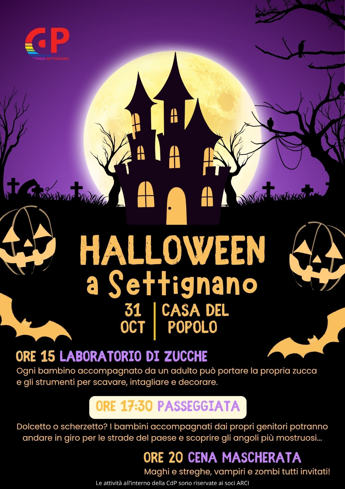
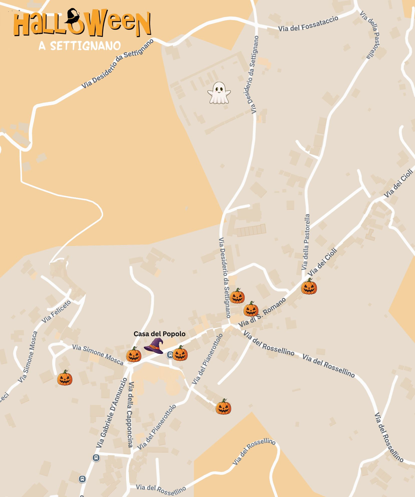

# Halloween a Settignano 2026

## Sabato 31 ottobre 

La notte più misteriosa e spaventosa dell’anno sta per tornare! 

Si parte alle 15:00 con il Laboratorio di Zucche.

Sarà un’occasione di condivisione a quattro mani, pensata proprio per far lavorare insieme grandi e piccini: i genitori rimarranno responsabili dei propri bimbi, mentre i nostri Fabio e Sara metteranno a disposizione tutto il supporto logistico necessario. Ciascuno dovrà portare la propria zucca e gli strumenti per intagliarla, scavarla e decorarla con colori e accessori. Se il tempo sarà clemente ci sistemeremo all’aperto nel piazzale, mentre in caso di pioggia ci sposteremo nella nostra ludoteca.   

Alle 17:30 prenderà il via la tanto attesa passeggiata per il “Dolcetto o Scherzetto?”. 

Per guidare i piccoli mostri tra le strade del paese, distribuiremo tramite QR Code la mappa con tutte le case che hanno confermato la propria disponibilità ad accoglierli e a regalare un po’ di dolci.   

## Abitanti di Settignano

👉 A questo proposito, lanciamo un appello a tutti gli abitanti di Settignano: sbizzarritevi e partecipate! 

Potete consultare la mappa aggiornata all’indirizzo settignano.org/halloween. Se volete aggiungere la vostra casa, vi basta inviare una mail a stefano.cecere@gmail.com oppure segnalarlo direttamente al gruppo genitori o in ludoteca. La sera del 31 ottobre, vi chiediamo di segnalare la vostra adesione accendendo una candela fuori dalla porta, oppure esponendo la locandina dell’evento o una decorazione a tema. 

Un piccolo suggerimento: fate scorta di caramelle e cercate di darne una a bambino, così ce ne saranno a sufficienza per tutti!   

## Cena

Infine, alle 20:00, ci ritroveremo tutti insieme per la Cena Mascherata alla Casa del Popolo: maghi, streghe, vampiri e zombi di ogni età sono caldamente invitati a tavola per concludere la serata in allegria.

## Mappa

Mappa in costruzione

<!--  -->
